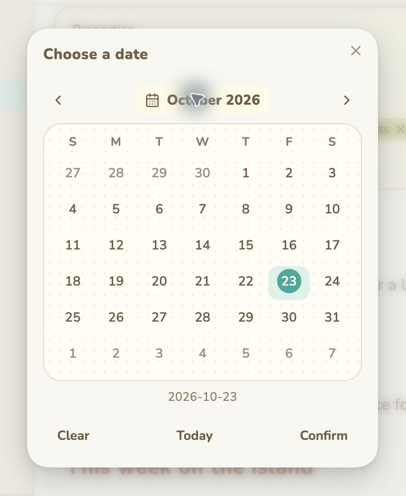

# Animal Island Calendar

A cozy paper-style date and time picker for Obsidian note Properties. Works on its own, and coordinates with [Animal Island Cozy](https://github.com/tiffanyiong/obsidian-animal-island).

## Features and usage

- Click a Date or Date & time property to open the picker. Keyboard users can press Enter or Alt+Down on the property.
- Pick a date, then press **Confirm** to save. **Today** selects today. **Clear** stages an empty value and still requires confirmation. Closing or pressing Escape cancels.
- Date & time properties include a time control. Changing the day preserves the existing time, including seconds. Values use local dates; no UTC day conversion is applied.
- Arrow keys move by day/week, PageUp/PageDown move by month, and Home/End move within a week.
- Supports English, Traditional Chinese and Simplified Chinese. It follows Obsidian unless the Animal Island Cozy theme language setting overrides it.
- With the theme and optional Style Settings plugin, translates only that theme’s setting labels and options in memory. Disabling restores them. Other plugins’ files are never modified.

This is a Properties picker, not an event planner or a daily-note sidebar calendar.

## Installation

When available in Community plugins, search for **Animal Island Calendar**, install and enable it. For manual installation, download `main.js`, `manifest.json`, and `styles.css` from this repository’s release into `<vault>/.obsidian/plugins/animal-island-calendar/`, restart Obsidian, then enable it in Community plugins. Disable it to restore native date controls.

No theme or other plugin is required for the picker. The independent theme-settings language bridge requires Animal Island Cozy and Style Settings.

## Privacy and compatibility

No analytics, network requests, external services or account are used. The plugin writes only the chosen frontmatter property through Obsidian’s `processFrontMatter` API, checking for concurrent changes before saving.

Initial beta: tested in Obsidian 1.14.5 on macOS. Automated checks cover local date arithmetic, language switching, staged save/cancel/clear, preserved time, conflict checks and early touch-event interception. The latest iOS native-picker suppression still needs physical-device confirmation; Windows, Linux, popout windows and minimum supported 1.5.0 are not fully verified. Obsidian Properties DOM and optional Style Settings internals may change in future versions.

## Original design credit

Inspired by **[Animal Island UI](https://guokaigdg.github.io/animal-island-ui/)**, created by **[guokaigdg](https://github.com/guokaigdg)** ([source](https://github.com/guokaigdg/animal-island-ui)). Full credit for the original visual direction belongs to its creator. Tiffany Iong implemented this independent Obsidian adaptation; it is not an official release by the UI author. Uses Obsidian’s built-in icons and APIs, with no React runtime.

## Development

Plain CommonJS JavaScript; `main.js` is both source and the release entry point. No build step or external runtime dependency. Run `node calendar.test.cjs` for behavior checks.

## License

MIT; see [LICENSE](LICENSE) and [THIRD_PARTY_NOTICES.md](THIRD_PARTY_NOTICES.md).
